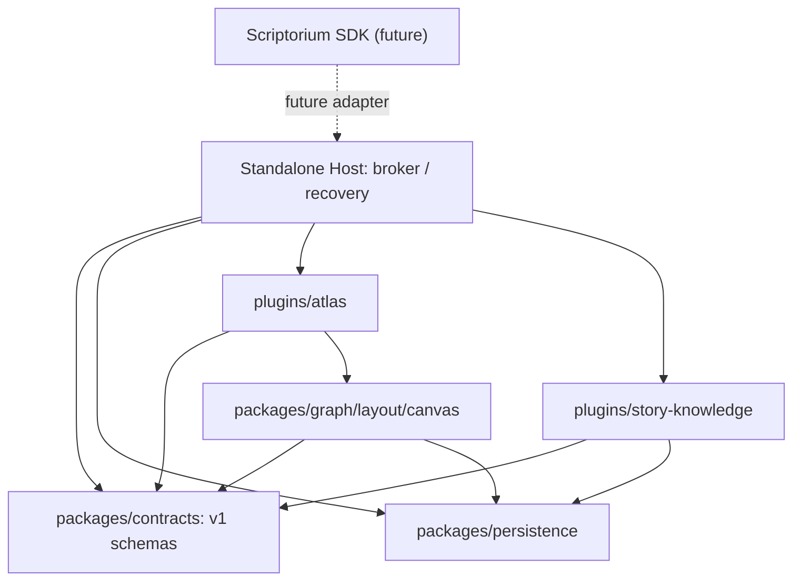

# Atlas / Story Knowledge V1 — 固定アーキテクチャ

**Status:** NORMATIVE / implementation pending。2026-10-20。対応[固定Goal](../goals/ATLAS-V1.md)。

## 1. 製品定義・実行責務

- **Atlas:** domain-neutral Graph/Canvas/Spatial Workspace。人物・舞台・伏線固有の意味を一切必須にしない。
- **Story Knowledge:** 人物/場所/勢力/アイテム/出来事/伏線/アーク/シーン/原稿などを管理する独立Plugin。Atlasなしで独立UIと保存を提供。
- **Graph Provider:** versioned・read-only・paged・snapshot-boundな複数Provider契約。Graph可視化・検索Consumerを持つ者はAtlas以外でも利用可。
- **Host:** 認可済みWorkspace、File/Revision、保存・Recovery、Plugin Grant/lease、連結、Lifecycleを管理。特定のPluginがSource of Truthとならない。
- **Scriptorium Adapter:** Standalone Host Portと将来の公開Scriptorium SDKだけを接続。公開SDKがない現状でfakeの本番接続はしない。

3 profileの単独動作が基礎、双方の連結は**独立したCapabilityの合成**。monorepoは開発・配布単位であり、単一Runtime/一体packageを意味しない。将来のrepo split/mergeでPlugin IDやData Format/ABIを変更しない。

## 2. 依存方向

Atlas↔Storyのprivate import禁止。両者の通信はHost Brokerから渡す純粋な契約データで、React component・closure・内部storeは共有しない。

## 3. パッケージ構成（正本）

| Path | Responsibility | Allowed dependency |
| --- | --- | --- |
| `packages/contracts` | Versioned JSON Schema、TS型/validators、Graph/Host/Doc contract | schema toolingのみ。Node/browser/React依存なし |
| `packages/graph` | Index、Neighbor、Path、Cluster、Filter、差分 | contracts |
| `packages/layout` | force/layered/timeline、Worker calculation、pin/seed | contracts、既存layout libraries |
| `packages/canvas` | Excalidraw adapter、Card/Shape mapping、exports | contracts。Story実装不可 |
| `packages/persistence` | Document serialization/validation、Host request helper | contracts。Git/credential書込不可 |
| `packages/scriptorium-adapter` | Host Port↔未来の公開SDK、availability | contracts。Scriptorium private imports不可 |
| `plugins/atlas` | Atlas UI/commands、metadata、Graph/Canvas/Board/Timeline | 共通packagesのみ |
| `plugins/story-knowledge` | parser/index/domain、Story-only UI、Graph Provider | contracts/persistenceのみ、Atlas/graph UI依存不可 |
| `apps/standalone` | 3組成、Host Broker、IndexedDB/Bundle、sandbox Frame、routing | 各packageのpublic exports、非公開src不可 |

Package名は `@scriptorium-atlas/<name>`、公開Plugin IDは `scriptorium.atlas` と `scriptorium.story-knowledge`。provider IDはStoryと同じ（ `scriptorium.story-knowledge` ）を既定とする。出力はESM、root entryから重いUI/Workerを自動importせず、exportsをmetadata/ui/workerに分離。独立packageがroot hoistによらずpack/consumerで動くこと。

## 4. 技術選択と交換条件

- pnpm workspace・TypeScript strict・React・Vite・Node 24開発。Standaloneは静的配信できる（資格情報不要）。
- Domain-neutral Graph UIは `@xyflow/react`。Forceは `d3-force`、DAG/SCC layeredは `elkjs` 等の既存Library（Worker）。独自SVG/Canvas図形ライブラリを再実装しない。
- Freeform: 公式 `@excalidraw/excalidraw` を利用し、PNG/SVG/標準形式を採用。Drawing mechanicsを再実装せず、参照カードをBindingで作る。
- Manifest/Data/Wire Schemaは一つの機械可読JSON Schema 2020-12を正本としTypeScript型・runtime Validator生成。非互換な重複定義を禁止。Graph Providerの操作とErrorは[契約](../contracts/GRAPH-PROVIDER-V1.md)で凍結。
- `yaml` Document/ASTにより未知フィールドとコメントを維持。CRDT/RTC/Rust/WASI移植はこのGoalには不要。
- Bootstrapで機能・license/interopの互換Versionを確認後 exact versions + lockfileを固定。実装中に曖昧なlatest更新を行わない。
- Canvasの大きな画像やSVGは適切な既存APIを使用し、独自ZIP/圧縮/描画engineを作らない。Web WorkerはGraph index/layout用。

## 5. Runtime・安全性

Standaloneは実行Hostを持ち、認証を備えた本番Scriptoriumとは区別する。プラグインのダウンロードや未署名の第三者任意コード実行はない。HostにSecret/Author token/稼働Git repo credentialsは置かない。

Plugin UI（Atlas/Story）はHostとは**異なるorigin**のstatic frameで稼働し、Host brokerとの間はschema検証済みMessageChannel。実開発時は127.0.0.1の異なるportで明確に分離できる。Parent iframeは `sandbox="allow-scripts"` を原則とし、必要な特別permissionがない限り `allow-same-origin` を与えない。WebWorker等のAPIがopaque originで必要なら、**別専用originを厳格に検証したうえで** `allow-same-origin` + `allow-scripts` を許可してよいが、同一origin、Credential、Host API/Cookie共有が存在しないことを受入で証明する。初期実装の選択は実Chrome/WebKitで機能を検証し、fail-closedで報告する。

Frameのロード時は origin/source/instance nonceを結び、transferred MessagePort上にEpoch/Call ID/Schema/Quota/Deadline/Cancelを持たせる。孤立Frame、古いEpochの応答、異なるWorkspace/Snapshot、権限のないActionをHostが拒否する。PluginからのURL navigate/popup/Host DOM/Secret直接アクセス禁止。Hostのwrite APIをplugin originでHTTP公開しない。Plugin UIのCSS・react runtimeはHost DOMに挿入しない。初期HMR例外を製品buildに持ち込まない。

Provider処理やLayoutはWorkerへ移し、Frame/Hostへの未検証object直接渡しなし。UI表示が消えてもAtlasがStory Providerを利用中ならProvider instanceはHost brokerがlease管理し、最後のconsumerで解放。アイドル時は不要なWorker・timer・index更新なし。Frame crash / Worker hangは対象PluginのみUnavailable、Hostと他方は継続。ただしrenderer一体OOM/browser自体終了を防ぐという**保証はしない**。OSレベル不審コード隔離、WASM/cgroupはScriptorium Plugin Platformの別実装Gate。

## 6. 責務：保存正本とLifecycle

| Object | Owner | Reconstructible |
| --- | --- | --- |
| YAML/Markdown Story Source | Workspace Host（外部Gitは将来Scriptorium Core） | NO |
| 手動Graph、Canvas/Excalidraw、pin、Board/Timeline | Host-owned document | NO |
| Graph Provider snapshot、Index、Layout結果 | Provider/Graph Cache | YES |
| Strict Journal / Local CAS/receipt | Standalone Host | NO（未確定分） |
| Hover、選択中focus、Drag進捗 | UI Session | YES |

Hostは原文のハッシュ/Revision・Change Intent・Generationを管理し、編集は手動Accept→Commitの順。保存成功表示は耐久性のあるトランザクション完了後だけ。Git保存（push/Checkpoint/Publish）はScriptoriumのSDKが実際に提供されるまではHost PortでUNAVAILABLE。Standaloneのexportを「GitHubへ保存済み」とは呼ばない。

自動レイアウトは手動座標の生成/補助であり、Story意味データの編集にならない。Drawn arrowはsemantic relationshipでなく、意味関係はStoryのCommand、元ファイルのread-setとReviewを必要とする。

## 7. プロファイルの依存閉包

| Profile | 必須bundle | 読み込んではいけないbundle |
| --- | --- | --- |
| `atlas` | Host + Atlas Graph/Canvas + manual provider + shared contracts | Story domain/parser/Story Worker |
| `story` | Host + Story UI/domain/parser + shared contracts | Excalidraw/React Flow/Atlas layout |
| `combined` | Host + 2 independently loadable plugins | private inter-plugin imports |

3 profileのbuild成果からimport closureを機械的に検査する。CSSで隠しただけ、Dynamic importを停止できないだけでは不合格。

## 8. ゴール/品質との関係

[31機能の固定定義](FEATURES-V1.md)、[Q01–Q15](../quality/ACCEPTANCE-V1.md)が完成条件。公開Plugin SDKの正式配布、外部Marketplace、旧Scriptorium Module削除、Kubernetes/OCI上の強隔離、NLPモデル、CRDTは除外。性能測定で課題が分かっても不必要なArchitecture再設計はしない。
